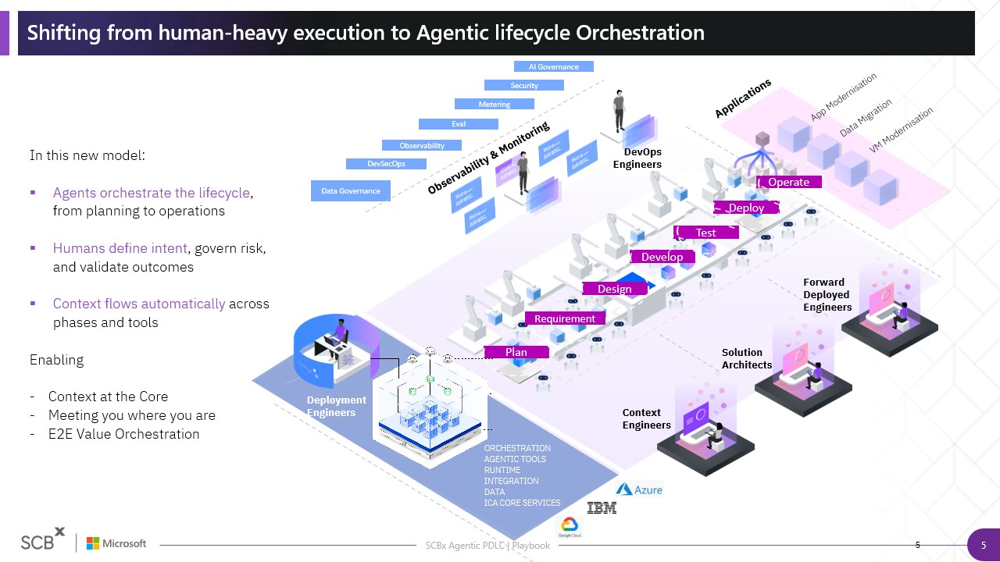

*Draft - 18 October 2026*

---

# Table of Contents

**The What**

1.1 [About this playbook](#about-this-playbook)
1.2 [What Agentic PDLC means](#11-what-agentic-pdlc-means)
* [Agent catalogue](../pages/agent-catalogue.md)
1.3 [Overview of Agentic PDLC end-to-end](#12-overview-of-agentic-pdlc-end-to-end)
*  [Best practices of Agentic PDLC](../pages/best-practices.md)
* [AI PDLC Lifecycle](../pages/ai-pdlc-lifecycle.md)
1.4 [Four changes in the delivery model](#13-four-changes-in-the-delivery-model)

**The Why**

2.1 [Design approach to Agentic PDLC](#21-reimagining-the-agentic-design-process)
2.2 [Design principles for building agents](#22-design-principles-for-building-agents)
2.3 [Governance and Controls](#23-governance-and-controls)
2.4 [Measurements](#24-measurements)

**The Who**

3.1 [Product squad roles](#31-product-squad-roles)

**The How**

4.1 [Identify the project type](#41-identify-the-project-type)
* [3.2 Greenfield development](../pages/3-2-greenfield-development.md)
* [3.3 Brownfield enhancement](../pages/3-3-brownfield-enhancement.md)
* [3.4 Modernisation and upgrade](../pages/3-4-modernisation-and-upgrade.md)
* [3.5 Hybrid programmes](../pages/3-5-hybrid-programmes.md)
4.2 [Baseline the current state](#42-baseline-the-current-state)
4.3 [Tailoring lifecycle activities](#43-tailoring-lifecycle-activities)
4.4 [Select relevant agents](#44-select-relevant-agents)
4.5 [Pilot pre-initiation and getting started](../pages/4-1-pilot-pre-initialisation.md)
- [Step-by-step agent walkthroughs](../pages/4-2-to-4-10-agent-walkthroughs.md)
4.6 [Templates and additional references](#templates-and-additional-references)

---

# About this playbook

This playbook helps product squads use Agentic PDLC in a consistent, practical and controlled way. It is written for people shaping products, translating needs into specifications, designing solutions, building and testing software, deploying releases and operating services in production.

---

# THE WHAT

*What is the problem statement? What are we doing here?*

## 1.1 What Agentic PDLC means

**Shifting from human-heavy execution to agentic lifecycle orchestration**
Agentic PDLC shifts product delivery from a sequence of predominantly human-executed activities to a governed system in which people and agents work across the lifecycle. Agents carry out defined analysis, generation, coordination and validation tasks from planning through operations. People continue to set intent, supply and approve context, govern risk and validate outcomes. The three ideas at the centre of the model are: context is carried across phases, squads can adopt the approach from their current starting point, and work is orchestrated end to end rather than through isolated AI tools.

The model has three core characteristics:

1. Agents support or execute work from planning through operations.
2. Humans define the objective, set boundaries, review material outputs and approve progression.
3. Context moves across phases so each activity can build on approved requirements, designs, decisions, standards and prior outputs.

Context is central. Agents should work from current, approved and well-structured requirements, designs, decisions, standards and system information. The approach therefore combines agent use with context engineering, delivery controls, evaluation, observability, security and evidence capture.

Agents do not share the background knowledge of the squad. They cannot draw on previous conversations, undocumented conventions or decisions that experienced team members simply "know." If this knowledge is not made explicit and included in the agent's working context, the agent cannot reliably apply it.

Providing more information is not necessarily the answer. Context is limited, and irrelevant, outdated or conflicting material can distract from the information that matters. Squads should therefore provide the right context, not all available context. This means identifying authoritative sources and supplying the approved requirements, architecture decisions, standards, constraints and acceptance criteria relevant to the task.

Even a capable agent can produce convincing but incorrect output when its context is incomplete or unclear. Reliable agent-enabled delivery therefore depends on well-structured context, clear instructions, defined constraints, evaluation and human review. Context should be treated as a governed delivery artefact that is prepared, approved and kept current throughout the lifecycle.

Before using an agent, the squad should confirm that the information needed for the task is approved, accessible, current and sufficiently specific.

Microsoft and IBM guidance both reinforce that agent quality must be assessed through the outcome and the execution process, including tool use and intermediate steps, rather than the final output alone.

**Useful links**
*What agent should I use?*
→  [Agent Catalogue](../pages/agent-catalogue.md)

*How to make it work better?*
→  [Best practices of Agentic PDLC](../pages/best-practices.md)

*What is the full AI PDLC?*
→   [AI PDLC Lifecycle](../pages/ai-pdlc-lifecycle.md)

---

## 1.2 Overview of Agentic PDLC end-to-end

**End-to-end flow and human approvals**
Agentic PDLC uses the same governed end-to-end workflow for greenfield and brownfield delivery, moving from enterprise context through specification, planning, implementation and validation to production and ongoing learning. The lifecycle combines continuous validation with human approval gates at defined points.

Greenfield and brownfield delivery follow the same workflow but draw on different context. Requirements context and design context provide inputs to the lifecycle, while brownfield delivery also incorporates relevant existing code, architecture, dependencies, incidents and technical debt.

| **Stage** | **Purpose** | **Typical output** |
|----|----|----|
| Discover / Context | Assemble the context required as input to the PDLC. This includes requirements context such as PRDs, FRDs, user stories, CR/BG and business rules; design context such as Figma, design systems, UI patterns and components; and, for brownfield delivery, existing code, architecture, dependencies, incidents and technical debt. | Requirements context, design context and brownfield context |
| Specify | Convert requirements and context into a clear technical specification. | `spec.md` and acceptance criteria |
| Plan | Define the solution approach, architecture impact and high-level design. | `plan.md`, architecture and impact analysis |
| Tasks | Break the solution down into dependent, actionable development tasks. | `tasks.md` and task dependencies |
| Implement | Develop code according to the defined tasks, with guardrails and real-time feedback. | Source code and unit tests |
| Test & Validate | Conduct continuous testing in parallel with implementation. | Test results and quality and security evidence |
| Build / Ship | Create a releasable build after all required quality gates have passed. | Release candidate and build artefacts |
| GreenLane CI/CD | Automate promotion through environments from DEV → SIT → QA → PROD. | Deployed version and deployment logs |
| Operate & Learn | Monitor production, learn from operational outcomes and feed insights back into context, particularly for brownfield delivery. | Operational insights and improvement recommendations |

### Human approval gates

Human oversight is maintained through approval gates across the lifecycle:

- **Product Owner approval** following Specify
- **Forward Deployed Architect (FDA) approval** following Plan
- **Forward Deployed Engineer (FDE) approval** following Tasks
- **Code review (FDE)** following Implement
- **Quality & Security gate approval (FDA)** following Test & Validate
- **Release readiness approval (FDE)** following Build / Ship
- **Deployment approval (PO/PM)** for GreenLane CI/CD
- **Ongoing review (Ops / System Manager)** during Operate & Learn

Validation is continuous across the flow. Code changes trigger tests, test feedback guides fixes during implementation, and production learning feeds back into brownfield context for continuous improvement.

---

## 1.3 Four changes in the delivery model

**Four core reframes**
Agentic PDLC changes more than the mechanics of software development. It shifts how teams create value, organise engineering work, measure success and structure delivery. Product teams move from delivering fixed scope to continuously improving outcomes; engineering moves from writing every line of code to orchestrating agent-enabled delivery; success moves from effort consumed to business impact realised; and large squads give way to smaller, AI-augmented pods supported by reusable context. These four reframes explain why Agentic PDLC requires a broader change to measures, roles, commercial models and ways of working, not simply the introduction of another developer tool.

| **Reframe** | **What changes** | **Practical implication** |
|----|----|----|
| **From feature factory to value engine** | Move from time-bound, fixed-scope projects focused on milestones and delivery speed to a continuous, user-centred product lifecycle aligned with business outcomes. | Continuous discovery becomes part of normal delivery. Teams own outcomes, and measures shift from features shipped to value realised. |
| **From writing code to orchestrating AI-powered delivery** | Move from developers producing each artefact and line of code to agents executing and coordinating repeatable work within human-defined architecture, specifications and controls. Quality is designed into specifications before implementation begins. | Developer roles evolve towards architecture, context engineering, orchestration and validation. Delivery capacity can scale through reusable agents, specifications and context, rather than through team size alone. |
| **From paying for time to investing in shared outcomes** | Move from assessing delivery through time, effort and adherence to budget to measuring business outcomes and return on investment. Value is engineered and validated throughout delivery rather than considered only after deployment. | Commercial and delivery measures become more closely aligned to tangible impact, including realised value, time to market and business performance. |
| **From large agile squads to smaller, smarter pods** | Move from large squads built around individual expertise to compact, AI-augmented pods supported by orchestrated agents and codified, reusable context. | Agents handle more repeatable execution while people focus on context, judgement and strategy. Delivery becomes less dependent on individual heroics and more systematic, reusable and repeatable. |

Together, these reframes represent a connected operating-model shift: teams continuously own value, people govern and orchestrate agent-enabled delivery, success is measured through business impact, and knowledge is codified so that smaller teams can deliver effectively at scale.

---

# THE WHY

*Why are we reimagining the way teams work? Why our Agentic way of working will work?*

## 2.1 Reimagining the agentic design process

If you are a designer, researcher or product owner working out what Agentic PDLC means for how you work, the short answer is this: the craft does not change. What changes is where your attention goes. Agents carry the mechanical parts -- organising evidence, drafting artefacts, checking citations -- which frees you for the work that actually requires a person.

The problem this is designed to solve is a familiar one. Product teams often work from separate assumptions about users and goals. Each function has its own read on the problem. That misalignment surfaces as rework, delayed timelines and designs that do not hold up to scrutiny. The design approach in Agentic PDLC keeps evidence connected across every phase, so the people working with it can trust it and the whole team designs from the same picture.

*Curious to find out more? Check out the detailed design approach:*
→ [Design approach to Agentic PDLC](../pages/design-approach.md)

---
## 2.2 Design principles for building agents
Five principles apply to every design capability in this playbook. They are not a checklist to review once and file. They are the criteria you use when deciding whether to go forward, and when questioning whether something has gone wrong.

|Principle|What it means for you|
|---|---|
|1. Human control|You set the scope, settle disagreements and sign off. Agents do not.|
|2. Speak the user's language|You write needs and findings the way users would say them, not as solutions.|
|3. Prevent errors|Agents never invent quotes, participants or evidence. If it is not in the evidence, it is not in the output.|
|4. Visible evidence|Every output points back to the evidence behind it, so anyone can check it.|
|5. Start simple|You add steps and artefacts only when you have a reason to.|

---

## 2.3 Governance and Controls

| **SECTION SUMMARY** | *Placeholder — content not yet created* |
|----|----|

> ⬛ *This section is planned but has not yet been authored. Content will cover the governance framework, approval authorities, risk controls and audit requirements for Agentic PDLC delivery.*

---

## 2.4 Measurements

| **SECTION SUMMARY** | *Placeholder — content not yet created* |
|----|----|

> ⬛ *This section is planned but has not yet been authored. Content will cover the metrics framework, KPIs, flow measures and value realisation indicators used to assess Agentic PDLC delivery performance.*

---

# THE WHO

*Who is involved?*

## 3.1 Product squad roles

Agentic delivery increases the importance of the team system. The role model shows how accountability is distributed when agents carry out more delivery work. Product and design roles continue to define outcomes and user intent. Architecture and engineering roles convert that intent into boundaries, specifications, context and executable work. Quality, security, DevOps and reliability roles validate the evidence and protect production outcomes. Agents increase team capacity, but they do not become accountable roles.

High-performing agentic teams make four practices explicit:

- **Knowledge**: Conventions, architecture decisions, controls and operating procedures are recorded rather than kept in individual memory.

- **Review**: Agent output is reviewed as seriously as human-produced output. Review is a quality activity, not a formality.

- **Specification**: Work is bounded and described clearly enough for people and agents to understand what must be done and what must not change.

- **Feedback**: Rework, context gaps and repeated failures are captured and used to improve the workflow and context.

### Core product squad roles

| **Role** | **Core accountability** |
|----|----|
| Product Owner | Owns the product vision, roadmap, backlog and business outcomes. Aligns priorities, makes trade-offs and approves product intent. |
| Forward Deployed Architect | Defines the scalable technical architecture, solution patterns, integration approach and architectural guardrails. |
| Product Designer | Designs the end-to-end user experience, translates user needs into journeys and interfaces, and supports adoption. |
| Forward Deployed Engineer | Connects approved architecture to executable delivery by managing context, specifications, agents, reviews and hand-offs. |
| Application Engineer | Builds, configures, tests and deploys product functionality. Remains accountable for implementation quality. |
| Quality Engineer | Defines and executes the test strategy, validates evidence and supports production-readiness decisions. |
| DevOps Engineer | Automates build, deployment and infrastructure processes and maintains reliable delivery pipelines and environments. |
| Site Reliability Engineer | Monitors service health, supports incident response and drives reliability and operational improvement. |
| Security Engineer | Embeds security, privacy and regulatory requirements from design through production and reviews relevant risks and guardrails. |

### How engineering roles evolve

Agentic PDLC does not create a clean break between "before" and "after" engineering roles. Instead, it changes where existing roles spend their time and where they create the most value.

The shift is from individual output towards team capability. Faster code generation alone does not create a high-performing agentic team. Agent performance depends on the quality of the context, specifications, review practices and feedback loops around it. A strong team therefore makes knowledge explicit, writes clear specifications, reviews agent output rigorously and learns systematically from failures.

Four team practices become particularly important:

- **Explicit knowledge:** Document conventions and architecture decisions so that knowledge is available to both people and agents rather than remaining tribal.
- **Strong review culture:** Treat review of agent output as a core engineering discipline rather than a final checkpoint.
- **Clear specification habits:** Give agents clearly scoped work with sufficient context rather than expecting vague requirements to be interpreted correctly.
- **Feedback loops:** Capture recurring failures and context gaps, then improve the shared context and ways of working so that the same problems are not repeated.

The practical implication is that Agentic PDLC should strengthen the capability of the whole squad rather than optimise for individual developer output.

---

# THE HOW

*How we work*

## 4.1 Identify the project type

**Greenfield, brownfield and modernisation paths**
Project classification determines the starting context and the lifecycle emphasis. Greenfield development creates a new target solution. Brownfield enhancement changes an application that will be retained. Modernisation changes the technical shape of an existing application, such as its architecture, runtime or deployment model. Integration or localisation connects or adapts a reusable capability. Classification should be applied to the bounded increment rather than the entire programme, because one programme may contain several paths.

**Before selecting agents, classify the project using the following questions:**
- Is this a completely new capability?
- Does a running application already exist?
- Are business requirements documented and approved?
- Is business logic embedded mainly in source code?
- Is the goal enhancement, replacement, modernization or technical upgrade?
- Is the target technology already approved?
- Is there a current architecture and dependency inventory?
- Are user journeys and design-system standards available?
- Is the change primarily integration or localization?
- Is a production-safe rollback path available?
- Which lifecycle artifacts can be reused?
- Which artifacts must be recovered or regenerated?

| **Path**                | **Use when**                                                                                                                                           | **Starting context**                                                                                                                | **Primary focus**                                                                                                                               |
| ----------------------- | ------------------------------------------------------------------------------------------------------------------------------------------------------ | ----------------------------------------------------------------------------------------------------------------------------------- | ----------------------------------------------------------------------------------------------------------------------------------------------- |
| Greenfield development  | Create a new product, service, journey or application, including replacing a legacy solution with a newly built target state.                          | Business opportunity, user need or problem statement and, where applicable, legacy behaviour, rules, data and exception paths.      | Shape outcomes → define product and target architecture → build and validate → transition from legacy where required.                           |
| Brownfield enhancement  | Retain the existing application and deliver a feature, regulatory change or increment.                                                                 | Approved backlog, specification, design or code.                                                                                    | Reuse context → clarify change → implement.                                                                                                     |
| Modernisation & upgrade | Transform an existing application by modernising its architecture, technology stack, framework, runtime, database, infrastructure or deployment model. | Source code, application behaviour, architecture documentation, component inventory, dependency maps and compatibility information. | Understand the current state → assess dependencies and constraints → define the target architecture → modernise, migrate, upgrade and validate. |

*For the detailed delivery path for each project type, see:*
→ [3.2 Greenfield development](../pages/3-2-greenfield-development.md)
→ [3.3 Brownfield enhancement](../pages/3-3-brownfield-enhancement.md)
→ [3.4 Modernisation and upgrade](../pages/3-4-modernisation-and-upgrade.md)
→ [3.5 Hybrid programmes](../pages/3-5-hybrid-programmes.md)

---

## 4.2 Baseline the current state

Before introducing Agentic PDLC, establish a clear baseline of how the team delivers today. The objective is not simply to document the formal SDLC, but to understand how work actually moves from demand through requirements, design, build, test, release and operation, including the tools, artefacts, hand-offs, approvals and workarounds used in practice.

The baseline should capture:

| Area | What to understand |
|----|----|
| **Delivery approach** | Whether the team works through Agile, Waterfall or a hybrid approach; the ceremonies, stages and approval points used in practice; and how consistently the stated methodology is followed. |
| **Project and change types** | The types of work typically delivered, such as greenfield development, enhancements, regulatory change, modernisation, upgrades or integration, and whether different types of work follow different delivery paths. |
| **Current SDLC / PDLC** | How work flows today from idea or request through requirements, design, backlog, planning, implementation, testing, release and operations, including key hand-offs and dependencies. |
| **Roles and ways of working** | Who performs each activity, who reviews or approves it, where specialist input is required, and where work waits for another person or team. |
| **Tools and workflow** | The systems used to manage requirements, backlog, source code, testing, CI/CD, approvals and operational work, and how information moves between those tools. |
| **Documentation and source of truth** | Where requirements, decisions, designs, standards, user stories and technical documentation are maintained, for example Jira, Confluence, repositories or other systems, and whether teams consistently use the agreed source of truth. |
| **Existing artefacts and context** | What approved requirements, architecture, design, code, standards, templates, test assets and other reusable context already exist; who owns them; and whether they are current and usable. |
| **Pain points and constraints** | Where teams experience delays, rework, duplication, unclear requirements, fragmented context, manual effort, repeated hand-offs, quality issues or other delivery challenges. |
| **Team needs** | What teams need in order to deliver more effectively, including better context, clearer specifications, improved tooling or integration, faster feedback, reduced manual work, or stronger review and governance support. |
| **Current performance** | What evidence is already available to establish the starting point for delivery performance, quality and flow so that future improvement can be measured rather than assumed. |

The baseline should reflect the way delivery actually works today, not only how the process is documented. This means understanding how work moves through the lifecycle in practice, where teams experience delays, rework or dependency on manual hand-offs, and where the actual way of working differs from the intended process.

Where data is available, complement this qualitative view with existing measures of delivery performance, such as lead time, cycle time, quality, rework and other relevant flow measures. The objective is not to introduce a new measurement framework, but to establish an evidence-based starting point against which changes introduced through Agentic PDLC can be assessed.

The output should be a concise current-state baseline of the delivery flow, roles, tools, artefacts, pain points, needs and available performance measures. This provides the reference point for identifying where agents could add value, what context or documentation needs to be strengthened, which existing practices should be retained, and how improvement will ultimately be demonstrated.

## 4.3 Tailoring lifecycle activities

The SCB Agentic PDLC provides a standard end-to-end lifecycle, but not every project needs to execute every activity in the same way. For each phase, the squad should determine whether the activity is **mandatory, conditional, reusable, skippable with evidence or not applicable** for the bounded increment.

The decision should reflect the project type, lifecycle entry point, approved artefacts already available and the specific requirements of the increment. Existing approved work should be reused where appropriate rather than recreated unnecessarily.

### Lifecycle tailoring rules

| Classification              | Application                                                                                                  |
| --------------------------- | ------------------------------------------------------------------------------------------------------------ |
| **Mandatory**               | The activity is required for the bounded increment.                                                          |
| **Conditional**             | The activity is required when the conditions relevant to that phase or project are present.                  |
| **Reusable**                | Existing approved artefacts or outputs can be used as inputs rather than recreated.                          |
| **Skippable with evidence** | The activity can be bypassed where sufficient approved evidence already exists and the decision is recorded. |
| **Not applicable**          | The activity does not apply to the bounded increment.                                                        |

Where a phase or activity is skipped, record:

- Reason for skipping
- Existing approved artefact
- Artefact owner
- Version or link
- Approving authority
- Risk created by the bypass
- Controls applied downstream

### Standard lifecycle

Lifecycle tailoring is applied against the standard SCB Agentic PDLC:

1. Mobilize and Assess
2. Discover and Frame
3. Contextualize
4. Define Requirements
5. Design Experience and Architecture
6. Create Backlog and Specification
7. Plan and Decompose
8. Build
9. Validate
10. Release
11. Operate and Improve

### Mandatory controls remain in place

Lifecycle tailoring changes **how the lifecycle is traversed**, not the requirement for evidence and accountability.

Where existing artefacts are reused, the squad should establish that the artefact is appropriate for the increment rather than regenerating it automatically. Where an activity is skipped, the reason, supporting evidence, ownership, approval, resulting risk and downstream controls must be recorded.

Human approval gates also continue to apply where required. Across the lifecycle these include intake approval, context readiness, requirements approval, design and architecture approval, backlog and specification approval, plan approval, pull request approval, quality approval and production readiness.

No implementation should begin until the approved plan satisfies the required planning gate, and no autonomous production promotion is permitted.

## 4.4 Select relevant agents

| **SECTION SUMMARY** | *Select the agents required for the project type and lifecycle activities being delivered.* |
|----|----|

Once the project type and lifecycle activities have been determined, identify the agents required to support the bounded increment. The current SCBx agent set spans requirements and discovery, design/backlog/specification, plan and build, and quality and release.

The slides distinguish between **Core** agents and **Custom** agents. Agent applicability also varies by project type. Greenfield delivery uses the requirements-building agents as part of the standard flow, while Brownfield and Modernisation may reuse existing approved artefacts and therefore treat some requirements and backlog agents as optional.

---

# *Ready to get started?*

→ [4.1 Pilot pre-initiation and getting started](../pages/4-1-pilot-pre-initialisation.md)
→ [4.2–4.10 Step-by-step agent walkthroughs](../pages/4-2-to-4-10-agent-walkthroughs.md)

---

# Templates and additional references

| **SECTION SUMMARY** | *Placeholder — content not yet created* |
|----|----|

> ⬛ *This section is planned but has not yet been authored. Content will include reusable templates, prompt patterns, reference checklists and additional resources to support Agentic PDLC delivery.*
